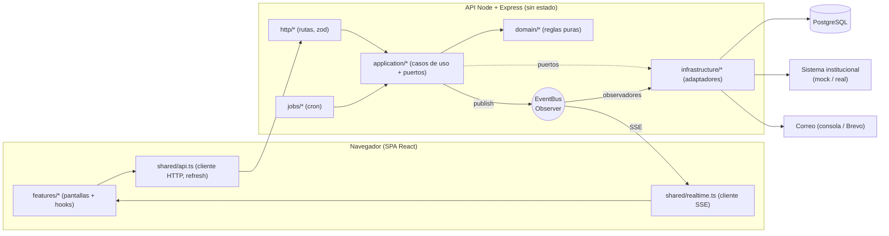
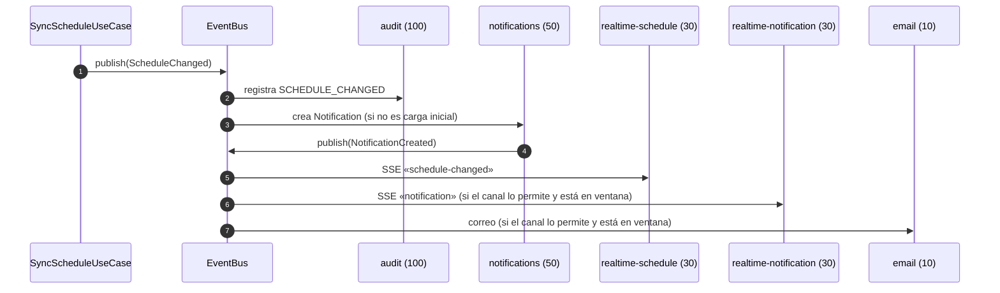
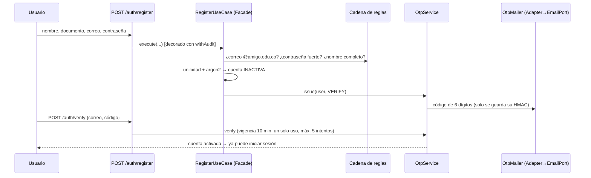
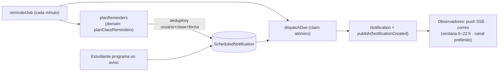

# Arquitectura de Horario UNI

Este documento describe la arquitectura del sistema **Horario UNI**: el estilo arquitectónico adoptado, la regla de
dependencias entre capas, la ubicación y justificación de cada patrón de diseño, el cumplimiento de los atributos de
calidad definidos en el documento de requisitos (SRS) y la trazabilidad requisito → código → prueba.

Este anexo complementa el documento principal con la visión general del sistema, los flujos principales y la trazabilidad de requisitos. El detalle de
cada patrón se presenta en el Anexo B y el índice de ubicaciones generado a partir del código fuente, en el Anexo C.

## 1. Estilo arquitectónico

**Monolito modular con arquitectura hexagonal (puertos y adaptadores)**, desplegado como una API sin estado
más una SPA.

| Decisión | Por qué |
|---|---|
| **Monolito modular**, no microservicios | El equipo es pequeño y el dominio es uno solo; los módulos (`auth`, `schedule`, `notifications`, `gaps`, `catalog`, `audit`, `realtime`) tienen fronteras claras y se podrían extraer más adelante. Evita la complejidad operativa de la red entre servicios. |
| **Hexagonal** (puertos y adaptadores) | El dominio y los casos de uso no conocen Express, Prisma, Brevo ni el sistema institucional: dependen de **interfaces (puertos)**. Se cambia un adaptador sin tocar la lógica y las pruebas usan dobles en memoria. |
| **Orientada a eventos (interna)** | Un bus de eventos tipado desacopla quién *produce* un hecho (se sincronizó un horario) de quién *reacciona* (auditar, notificar, avisar en vivo, enviar correo). Es el patrón Observer. |
| **Backend sin estado** | JWT + refresh token rotativo; los revocados y el estado viven en PostgreSQL. Permite escalar horizontalmente (RNF-10). |
| **SPA por *features*** | El frontend se organiza por funcionalidad (`features/schedule`, `features/gaps`…), no por tipo de archivo. |



## 2. Regla de dependencia y capas

Las flechas apuntan **hacia adentro**. Nada en el dominio importa de las capas externas.

```
   http  ───────►  application  ───────►  domain
                        ▲
                        │ implementa los puertos que define application
                  infrastructure
```

| Carpeta (dentro de cada módulo) | Capa | Contiene | No puede |
|---|---|---|---|
| `domain/` | Dominio | Entidades, reglas puras, especificaciones, estrategias. Sin I/O. | Importar Express, Prisma, `fetch`, `process.env` |
| `application/` | Aplicación | **Casos de uso** (`execute(input)`), **puertos** (`ports.ts`), servicios de aplicación | Conocer Prisma/HTTP; solo habla con puertos |
| `infrastructure/` | Adaptadores de salida | Prisma, argon2, JWT, Brevo, mock institucional, exportadores | Contener reglas de negocio |
| `http/` | Adaptadores de entrada | Rutas Express, validación `zod`, mapeo a JSON | Contener reglas de negocio |
| `shared/` | Núcleo compartido | Composición (`container.ts`), bus de eventos, errores, middlewares | Depender de un módulo concreto salvo en el contenedor |
| `jobs/` | Disparadores | Trabajos `cron` que llaman a casos de uso | — |

La regla se ve en el código: `backend/src/modules/*/domain` no tiene ningún `import` de `express`/`@prisma/client`,
y los tests de dominio corren sin base de datos.

## 3. Módulos

| Módulo | Responsabilidad | Requisitos |
|---|---|---|
| [`auth`](../backend/src/modules/auth/README.md) | Registro, OTP, sesión (JWT + refresh), perfil, roles | RF-AUTH-01..07, RNF-04/05/06/07, RRF-06 |
| [`schedule`](../backend/src/modules/schedule/README.md) | Horario semanal, detalle, sincronización, exportación, búsqueda/filtros, panel admin | RF-HOR-01..05, RF-BUS-01/02, RF-ADM-03, RRF-01/02/04/07 |
| [`gaps`](../backend/src/modules/gaps/README.md) | Huecos, sugerencias, actividad propia, disponibilidad | RF-HUE-01..04 |
| [`notifications`](../backend/src/modules/notifications/README.md) | Notificaciones en la app, correo, recordatorios, programadas, canal | RF-NOT-01..04, RRF-05 |
| [`realtime`](../backend/src/modules/realtime/README.md) | Flujo SSE hacia el navegador | RF-NOT-03 |
| [`catalog`](../backend/src/modules/catalog/README.md) | Facultades y programas | RF-ADM-01, RRF-03 |
| [`audit`](../backend/src/modules/audit/README.md) | Registro y consulta de auditoría | RF-ADM-02, RNF-14 |

## 4. Catálogo de patrones de diseño

Cada fila indica **qué problema resuelve aquí** y dónde verlo.

### Patrones creacionales

| Patrón | Dónde | Problema que resuelve |
|---|---|---|
| **Factory (Method)** | [`buildEmailAdapter`](../backend/src/modules/notifications/infrastructure/buildEmailAdapter.ts) · [`buildScheduleSpec`](../backend/src/modules/schedule/domain/specifications.ts) | Decidir *qué* objeto crear según la configuración (correo en consola vs Brevo; qué filtros componer) sin que el cliente conozca las clases concretas. |
| **Singleton** | [`shared/prisma.ts`](../backend/src/shared/prisma.ts) · [`shared/config.ts`](../backend/src/shared/config.ts). `EventBus` y `SseHub` son instancias únicas **por composición** (se crean una vez en `wire()` y se inyectan), no singletons globales | Un único *pool* de conexiones y una única configuración por proceso. |
| **Dependency Injection** (composición) | [`shared/container.ts`](../backend/src/shared/container.ts) (`buildContainer`) y [`main.ts`](../backend/src/main.ts) (`wire`) | Un solo lugar ("composition root") ensambla casos de uso con sus adaptadores. Los tests inyectan dobles en memoria. |

### Patrones estructurales

| Patrón | Dónde | Problema que resuelve |
|---|---|---|
| **Repository** | Puertos en `*/application/ports.ts` ([auth](../backend/src/modules/auth/application/ports.ts), [schedule](../backend/src/modules/schedule/application/ports.ts), [notifications](../backend/src/modules/notifications/application/ports.ts), [gaps](../backend/src/modules/gaps/application/ports.ts)); implementaciones `Prisma*Repository` y `InMemory*` en [tests/helpers](../backend/tests/helpers/inMemory.ts) | Aislar la persistencia: el caso de uso pide "guardar este OTP" sin saber si es SQL o memoria. |
| **Adapter** | [`MockInstitutionalAdapter`](../backend/src/modules/schedule/infrastructure/MockInstitutionalAdapter.ts) (→ `InstitutionalPort`) · [`BrevoEmailAdapter`/`ConsoleEmailAdapter`](../backend/src/modules/notifications/infrastructure) (→ `EmailPort`) · [`EmailOtpMailer`](../backend/src/modules/auth/infrastructure/EmailOtpMailer.ts) (adapta `EmailPort` al puerto `OtpMailer` de auth) · [`Argon2Hasher`](../backend/src/modules/auth/infrastructure/Argon2Hasher.ts) · [`JwtTokenService`](../backend/src/modules/auth/infrastructure/JwtTokenService.ts) | Conectar una API externa o librería a la interfaz que espera el dominio. Para usar el sistema institucional real solo se escribe otro adaptador. |
| **Facade** | [`SyncScheduleUseCase`](../backend/src/modules/schedule/application/SyncSchedule.ts) (adaptador → diff → persistencia → eventos) · [`RegisterUseCase`](../backend/src/modules/auth/application/Register.ts) · [`GapService`](../backend/src/modules/gaps/application/GapUseCases.ts) | Una interfaz simple (`execute`) que oculta una orquestación de varios pasos y subsistemas. |
| **Decorator** | [`withAudit`](../backend/src/shared/audit.ts) aplicado en el contenedor a login, registro, sincronización, roles, catálogo… · [`DevLoggingOtpMailer`](../backend/src/modules/auth/infrastructure/DevLoggingOtpMailer.ts) | Añadir comportamiento transversal (auditar, loguear el OTP en desarrollo) **sin modificar** la clase decorada. |
| **Proxy / Interceptor** | [`frontend/src/shared/api.ts`](../frontend/src/shared/api.ts) | El cliente HTTP intercepta cada respuesta 401, rota el *refresh token* una sola vez (*single-flight*) y reintenta; las pantallas no requieren conocer este mecanismo. |
| **Specification** | [`schedule/domain/specifications.ts`](../backend/src/modules/schedule/domain/specifications.ts) (réplica cliente: [`filter.ts`](../frontend/src/features/schedule/filter.ts)) | Criterios de búsqueda reutilizables y combinables (`and`/`or`/`not`): nombre/código, día, bloque, docente. |

### Patrones de comportamiento

| Patrón | Dónde | Problema que resuelve |
|---|---|---|
| **Observer** (eventos de dominio) | [`EventBus`](../backend/src/shared/events/EventBus.ts) + observadores [`audit`](../backend/src/modules/audit/auditObserver.ts), [`notifications`](../backend/src/modules/notifications/application/NotificationObserver.ts), [`email`](../backend/src/modules/notifications/application/EmailObserver.ts), [`realtime-*`](../backend/src/modules/realtime/RealtimeObserver.ts), [`sync-stats`](../backend/src/modules/schedule/observers/syncStatsObserver.ts); en el navegador [`RealtimeClient`](../frontend/src/shared/realtime.ts) | Reaccionar a un hecho sin que el productor conozca a los consumidores. Añadir un observador no toca `SyncSchedule`. Ver §5. |
| **Strategy** | [`gaps/domain/suggestions.ts`](../backend/src/modules/gaps/domain/suggestions.ts) (descanso/alimentación/estudio por duración) · [`notifications/domain/channelPolicy.ts`](../backend/src/modules/notifications/domain/channelPolicy.ts) (qué canales usa cada preferencia) · exportadores por formato `Record<ExportFormat, BaseExporter>` | Intercambiar algoritmos/reglas sin `if/else`: añadir una regla nueva = una estrategia nueva (Open/Closed). |
| **Template Method** | [`BaseExporter`](../backend/src/modules/schedule/infrastructure/exporters/BaseExporter.ts) → `PdfExporter`, `IcsExporter` | El esqueleto de la exportación (filtrar activas y ordenar, `render`, nombrar el archivo) es fijo; solo cambia el paso `render`. |
| **Chain of Responsibility** | Middlewares [`authenticate → requireRole → zod → errorHandler`](../backend/src/shared/http/auth.ts) · [`registrationRules.ts`](../backend/src/modules/auth/domain/registrationRules.ts) (cadena de validación del registro) · [`ProtectedRoute`](../frontend/src/shared/ProtectedRoute.tsx) | Cada eslabón decide si pasa, rechaza o transforma; se pueden añadir eslabones sin tocar los demás. |
| **Command / Use Case** | Interfaz [`UseCase<I, O>`](../backend/src/shared/ports.ts) con `execute(input)`: todos los casos de uso | Cada acción del sistema es un objeto con una sola operación: se puede decorar (auditar), probar aislada y reutilizar desde HTTP o desde un job. |
| **Idempotent Consumer / Atomic claim** | [`claimEmail`](../backend/src/modules/notifications/application/ports.ts), [`claimDue`](../backend/src/modules/notifications/infrastructure/PrismaScheduledNotificationRepository.ts), [`consume` del refresh token](../backend/src/modules/auth/infrastructure/PrismaRefreshTokenRepository.ts), `dedupKey` de recordatorios | Que dos réplicas o reintentos no envíen dos veces el mismo correo ni usen dos veces un token. (Táctica de confiabilidad más que patrón GoF.) |

### En el frontend (React)

| Patrón | Dónde |
|---|---|
| **Provider / Context** | [`AuthProvider`](../frontend/src/features/auth/AuthContext.tsx), [`ToastProvider`](../frontend/src/features/notifications/ToastProvider.tsx), [`RealtimeProvider`](../frontend/src/shared/RealtimeProvider.tsx) |
| **Custom Hooks (contenedor / presentación)** | [`useSchedule`](../frontend/src/features/schedule/useSchedule.ts), [`useNotifications`](../frontend/src/features/notifications/useNotifications.ts): el hook obtiene datos, el componente solo dibuja |
| **Componentes reutilizables (DRY)** | [`shared/forms.tsx`](../frontend/src/shared/forms.tsx): `Field`, `AuthShell`, avisos; un solo estilo y un solo lugar para la accesibilidad |
| **Guard (ProtectedRoute)** | [`ProtectedRoute`](../frontend/src/shared/ProtectedRoute.tsx): decide por rol antes de renderizar |

## 5. El patrón Observer paso a paso

El bus es el *Subject*; los observadores se suscriben por **tipo de evento** en [`registerObservers.ts`](../backend/src/shared/registerObservers.ts)
(único lugar de cableado). Entrega en secuencia por prioridad, aislamiento de fallos, reintentos con *backoff* exponencial y registro de cada
entrega en `EventDelivery` (consultable en el panel de administración «Eventos recientes»).



Eventos: `ScheduleChanged`, `SyncCompleted`, `SyncFailed`, `NotificationCreated` (catálogo tipado en
[`events/types.ts`](../backend/src/shared/events/types.ts)). La semántica completa del bus se documenta en la sección «Eventos y patrón Observer» del README del proyecto.

**Cómo se extiende:** para reaccionar a un evento nuevo (p. ej. enviar un SMS) se escribe un observador y se añade **una línea** en
`registerObservers.ts`. Ningún caso de uso existente cambia: eso es el principio abierto/cerrado.

## 6. Flujos principales

### 6.1 Registro y verificación (RF-AUTH-01/05, RRF-06, RNF-07)



El OTP **no viaja por el bus de eventos** a propósito: el bus persiste los payloads en `DomainEvent` y un código de un solo uso no debe quedar en
una tabla de historial. Por eso se entrega por un puerto dedicado (`OtpMailer`).

### 6.2 Sesión (RF-AUTH-02/03, RNF-05)

Login devuelve un **access token** (JWT, 60 min) y un **refresh token** opaco (7 días, solo se guarda su hash sha256). `POST /auth/refresh`
lo **rota**: el anterior queda revocado y reutilizarlo falla. `logout` revoca el `jti` del access token y el refresh. Cambiar o recuperar
la contraseña revoca todos los refresh tokens del usuario.

### 6.3 Notificaciones programadas y recordatorios (RF-NOT-01/02)



### 6.4 Huecos (RF-HUE-01..04)

`detectGaps` (dominio puro) calcula los espacios entre clases consecutivas del mismo día (≥ 15 min); `GapService` los combina con las
actividades y el estado (ocupado/disponible) del estudiante; `suggestFor` (Strategy) propone una actividad según la duración, salvo que el
hueco esté ocupado o tenga actividad propia.

## 7. Atributos de calidad → tácticas (SRS)

| Atributo (sub-atributo) | Táctica aplicada | Evidencia |
|---|---|---|
| **Usabilidad** – protección a errores | Validación en tiempo real y botón deshabilitado hasta datos válidos | [`registrationRules.ts`](../frontend/src/features/auth/registrationRules.ts), `RegisterPage.test.tsx` |
| Usabilidad – operabilidad | Acciones principales a ≤ 2 clics: barra de secciones persistente | [`Layout.tsx`](../frontend/src/shared/Layout.tsx) |
| Usabilidad – accesibilidad (WCAG 2.1 AA) | Etiquetas, foco visible, `aria-live`, objetivos ≥ 44 px, navegación por teclado | componentes de [`shared/forms.tsx`](../frontend/src/shared/forms.tsx); tests con roles |
| **Seguridad** – confidencialidad | `assertCanView`: un estudiante solo ve su horario; hash argon2; OTP guardado como HMAC | [`access.ts`](../backend/src/modules/schedule/domain/access.ts), [`CryptoOtpCodec`](../backend/src/modules/auth/infrastructure/CryptoOtpCodec.ts) |
| Seguridad – integridad | Único escritor del horario = la sincronización; entradas `zod .strict()` | `SyncScheduleUseCase`, test «no existen rutas de escritura» |
| Seguridad – no repudio / trazabilidad | `withAudit` registra actor, acción y fecha; consulta en `GET /admin/audit` | [`audit.ts`](../backend/src/shared/audit.ts), [`AuditPage`](../frontend/src/features/admin/AuditPage.tsx) |
| Seguridad – autenticidad | OTP de un solo uso (10 min, 5 intentos) en registro y recuperación | [`OtpService`](../backend/src/modules/auth/application/OtpService.ts) |
| **Rendimiento** – tiempo de respuesta | Índices por `(userId, semestre, día)`; huecos calculados en memoria sobre el horario del usuario | `schema.prisma`, prueba de carga en README |
| Rendimiento – uso de recursos | Sincronización masiva y recordatorios en **jobs** (cron), concurrencia limitada | [`jobs/`](../backend/src/jobs) |
| Rendimiento – capacidad / escalamiento | Sin estado + reclamos atómicos para que varias réplicas no dupliquen trabajo | `claimDue`, `claimEmail`, `tryStart` |
| **Disponibilidad** (RNF-15) | Servicio `backup` con `pg_dump` diario | `docker-compose.yml` |
| **Mantenibilidad** (RNF-11) | Capas + puertos; cobertura backend ≈ 99 % líneas (umbral 70 %) | `backend/vitest.config.ts` |

## 8. Trazabilidad de requisitos

| Requisito | Implementación | Prueba |
|---|---|---|
| RF-AUTH-01 Registrar usuario | `Register.ts`, `registrationRules.ts`, `POST /auth/register` | `auth/accounts.test.ts`, `auth/registrationRules.test.ts`, `RegisterPage.test.tsx` |
| RF-AUTH-02 Iniciar sesión | `Login.ts`, `JwtTokenService.ts` | `auth/Login.test.ts`, `http/fullFlow.test.ts` |
| RF-AUTH-03 Cerrar sesión | `Logout.ts`, `PrismaRevokedTokenRepository.ts` | `auth/Logout.test.ts` |
| RF-AUTH-04 Recuperar contraseña (OTP 10 min) | `PasswordReset.ts`, `OtpService.ts` | `auth/accounts.test.ts` |
| RF-AUTH-05 Verificar cuenta | `VerifyAccount.ts` (cuenta inactiva hasta confirmar) | `auth/accounts.test.ts`, `VerifyPage.test.tsx` |
| RF-AUTH-06 Editar perfil (no el correo ni el documento) | `UpdateProfile.ts`, `PUT /auth/me` (`.strict()`) | `auth/accounts.test.ts`, `ProfilePage.test.tsx` |
| RF-AUTH-07 Gestionar roles | `ManageUsers.ts`, `PUT /admin/users/:id/role` | `http/fullFlow.test.ts`, `AdminPages.test.tsx` |
| RF-HOR-01..05 | módulo `schedule` | `schedule/**` |
| RF-HUE-01 Detectar huecos | `gaps/domain/gaps.ts` | `gaps/gaps.test.ts` |
| RF-HUE-02 Sugerir por duración | `gaps/domain/suggestions.ts` (Strategy) | `gaps/gaps.test.ts` |
| RF-HUE-03 Actividad propia (CRUD) | `CreateActivityUseCase`, `UpdateActivityUseCase`, `RemoveActivityUseCase` | `gaps/gaps.test.ts`, `GapsPage.test.tsx` |
| RF-HUE-04 Disponible / ocupado | `SetGapStatusUseCase` | ídem |
| RF-NOT-01 Notificación propia | `CreateCustomNotificationUseCase` | `notifications/scheduled.test.ts`, `NotificationsPage.test.tsx` |
| RF-NOT-02 Recordatorio configurable (15 min por defecto) | `reminders.ts`, `planReminders`, `reminderJob.ts` | `notifications/scheduled.test.ts` |
| RF-NOT-03 Aviso de cambio | `NotificationObserver` | `notifications/NotificationObserver.test.ts` |
| RF-NOT-04 Canal preferido | `channelPolicy.ts` + `EmailObserver`/`RealtimeObserver` | `notifications/scheduled.test.ts` |
| RF-BUS-01 Buscar asignatura (tiempo real) | `specifications.ts`; filtrado instantáneo en `filter.ts` | `schedule/domain/specifications.test.ts`, `filter.test.ts` |
| RF-BUS-02 Filtrar por día/bloque/docente | ídem | ídem |
| RF-ADM-01 Catálogo programas/facultades | módulo `catalog` | `catalog/catalog.test.ts`, `AdminPages.test.tsx` |
| RF-ADM-02 Auditar accesos y cambios | `withAudit` + `GET /admin/audit` | `http/fullFlow.test.ts`, `AdminPages.test.tsx` |
| RF-ADM-03 Sincronización masiva | `SyncSchedule.ts`, `syncJob.ts` | `schedule/application/**` |
| RRF-01 Matrícula vigente | `EnrollmentRepository` | `GetWeeklySchedule.test.ts` |
| RRF-02 / RRF-07 Horario oficial único | solo `SyncScheduleUseCase` escribe | `http/api.test.ts` |
| RRF-03 Programa ⇒ facultad | `CreateProgramUseCase` exige facultad existente | `catalog/catalog.test.ts` |
| RRF-04 Privacidad de horario | `assertCanView` + auditoría de terceros | `schedule/domain/access.test.ts` |
| RRF-05 Ventana 6–22 h | `shared/window.ts`, observadores | `shared/window.test.ts` |
| RRF-06 Solo correo @amigo.edu.co | `institutionalEmailRule` | `auth/registrationRules.test.ts` |
| RNF-04 Hash seguro | argon2 | — (adaptador) |
| RNF-05 JWT 60 min + refresh | `JwtTokenService`, `RefreshTokenService` | `auth/accounts.test.ts`, `shared/api.test.ts` |
| RNF-06 RBAC | `requireRole` | `http/*.test.ts` |
| RNF-07 OTP en registro y recuperación | `OtpService` | `auth/accounts.test.ts` |
| RNF-14 Trazabilidad | `withAudit`, `AuditLog` | `shared/audit.test.ts` |

## 9. Decisiones de arquitectura (resumen)

| # | Decisión | Alternativa descartada | Motivo |
|---|---|---|---|
| 1 | Monolito modular hexagonal | Microservicios | Un dominio, equipo pequeño; menos complejidad operativa. |
| 2 | Bus de eventos **en memoria** con historial en BD | Cola externa (RabbitMQ/Kafka) | Suficiente para el volumen; el historial (`DomainEvent`/`EventDelivery`) da trazabilidad. Migrar a una cola solo cambia `EventBus`. |
| 3 | SSE para tiempo real | WebSockets | Solo hay flujo servidor→cliente; SSE es más simple y atraviesa proxies. |
| 4 | OTP por puerto dedicado, **no** por el bus | Publicar `OtpIssued` | El bus persiste payloads; el código no debe quedar en el historial. |
| 5 | Refresh token opaco y rotativo en BD | JWT de larga vida | Se puede revocar y detectar reutilización. |
| 6 | Filtro de horario duplicado en cliente (réplica de la Specification) | Una petición por tecla | Respuesta instantánea; el servidor admite los mismos filtros para otros clientes. |
| 7 | Reclamos atómicos en BD | Bloqueos distribuidos | Funciona con varias réplicas sin infraestructura extra. |

## 10. API versionada y documentación OpenAPI (Swagger)

| Tema | Decisión | Dónde |
|---|---|---|
| **Versionado** | Por URL: todo cuelga de `/api/v1`. Un cambio incompatible irá a `/api/v2` sin tocar v1. Las rutas sin versión (`/api/...`) siguen respondiendo pero marcadas como obsoletas (`Deprecation: true` y `Link: …; rel="successor-version"`). | `shared/http/v1.ts`, `shared/http/app.ts` |
| **Documentación** | OpenAPI 3.0.3 generado desde los **mismos esquemas zod** que validan las rutas: no puede divergir. Swagger UI en `/api/v1/docs`, contrato en `/api/v1/openapi.json`. | `shared/openapi/` |
| **Antideriva** | Un test compara las rutas reales de Express con las documentadas: falla si hay una ruta sin documentar o documentación huérfana, y valida el documento con `swagger-parser`. | `tests/openapi/openapi.test.ts` |
| **Seguridad** | Esquema `bearerAuth` (JWT); cada operación indica su rol (`STUDENT`/`ADMIN`) y los endpoints públicos están acotados por un test. | `shared/openapi/registry.ts` |
| **Errores** | Un solo formato `{ code, message, issues?, requestId }` documentado como `ErrorResponse`, con respuestas reutilizables (400, 401, 403, 404, 409, 413, 429). | `shared/http/errorHandler.ts` |
| **Trazabilidad por petición** | `X-Request-Id` (se respeta el del cliente si es seguro o se genera) en la respuesta y en todo error. | `shared/http/requestContext.ts` |
| **Privacidad** | `Cache-Control: no-store` en la API (datos personales). | `shared/http/requestContext.ts` |
| **Códigos HTTP** | `201` al crear, `204` sin contenido, `409` conflicto, `429` límite de solicitudes. | rutas de cada módulo |

Para añadir un endpoint: crear la ruta, exportar su esquema zod desde el `schemas.ts` del módulo y registrarlo con `op({...})` en `shared/openapi/paths.ts`; si se olvida, el test falla.

## 11. Convención de marcado de patrones en el código

Toda clase, función o interfaz que implementa un patrón de diseño se anota en su JSDoc con la etiqueta estándar
`@pattern <Patrón> | <Rol> | <Justificación>`. Un script (`scripts/patterns-index.mjs`) recorre el código fuente y genera el índice de
ubicaciones (archivo y línea vigentes), y una prueba automatizada verifica que cada patrón declarado conserve al menos una marca.

## 12. Cómo extender

| Necesidad | Procedimiento |
|---|---|
| Reaccionar a un evento (SMS, Slack…) | Crear el observador y suscribirlo en `registerObservers.ts`. |
| Una regla de sugerencia nueva | Nueva `SuggestionStrategy` en `gaps/domain/suggestions.ts` y añadirla a `DEFAULT_STRATEGIES`. |
| Otra validación de registro | Nuevo eslabón `RegistrationRule` en `DEFAULT_REGISTRATION_CHAIN`. |
| Otro formato de exportación | Subclase de `BaseExporter` y registrarla en `main.ts`. |
| Un canal de notificación nuevo | Ampliar `channelPolicy.ts` y `NotifyChannel`. |
| El sistema institucional real | Implementar `InstitutionalPort` y cambiarlo en `wire()`. |
| Otra base de datos | Nuevas clases que implementen los `*Repository`; los casos de uso no cambian. |
