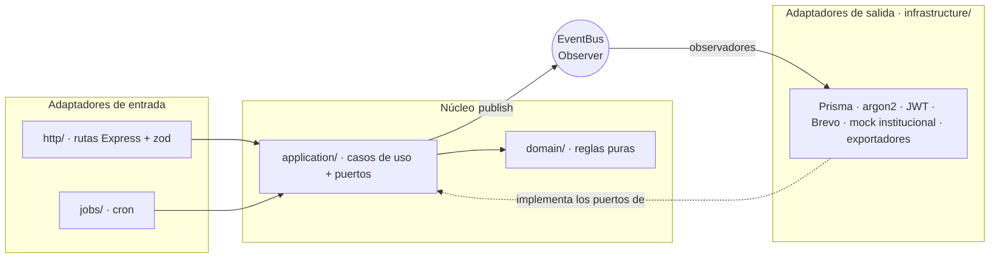
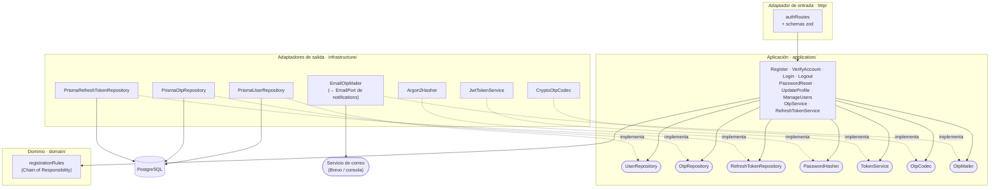
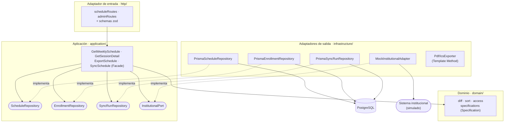
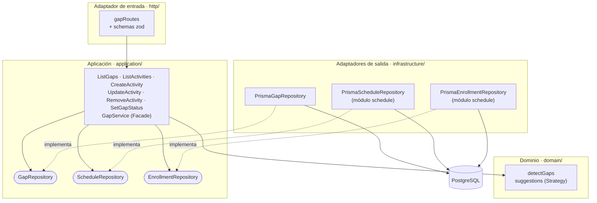
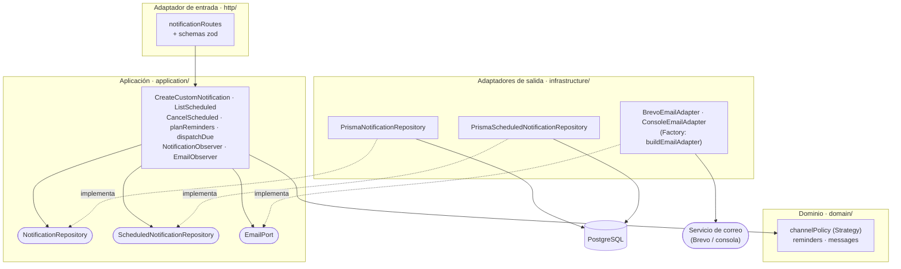
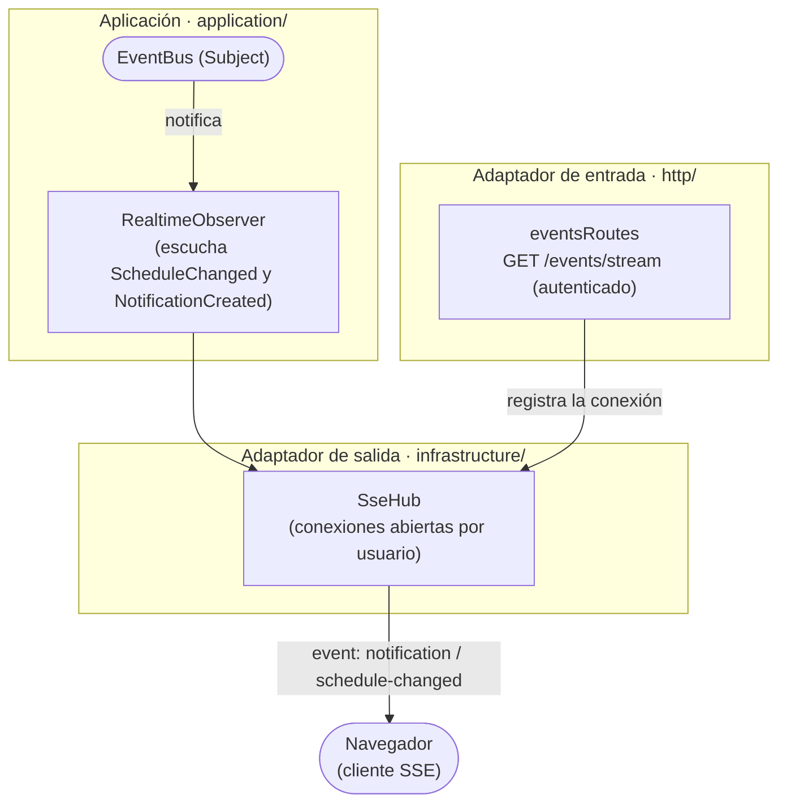
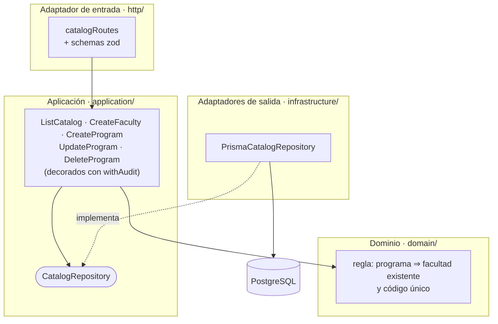
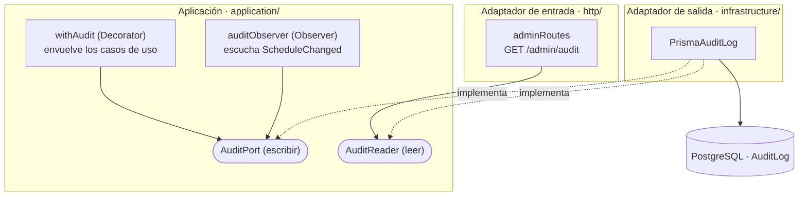
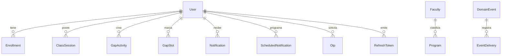

# Documento de arquitectura — Horario UNI

**Repositorio:** https://github.com/DilanRojasca/HorarioAQ · **API (Swagger):** `http://localhost:4000/api/v1/docs`

## 1. Introducción y alcance

Horario UNI es una aplicación web de gestión académica personal para estudiantes de la Universidad Católica Luis Amigó: centraliza el horario institucional, identifica los tiempos libres entre clases, notifica los cambios y ofrece herramientas de administración. Este documento describe la arquitectura del sistema completo, organizada por módulos, y expone la evidencia de los principios de diseño, los patrones y la API.

**Módulos del sistema** (cada uno es una rebanada vertical con las mismas cuatro carpetas: `domain`, `application`, `infrastructure`, `http`):

| Módulo | Responsabilidad | Requisitos del SRS |
|---|---|---|
| `auth` | Registro con OTP, sesión (JWT + refresh), recuperación de contraseña, perfil y roles | RF-AUTH-01..07, RNF-04/05/06/07, RRF-06 |
| `schedule` | Horario semanal, detalle, búsqueda y filtros, exportación PDF/.ics, sincronización institucional | RF-HOR-01..05, RF-BUS-01/02, RF-ADM-03, RRF-01/02/04/07 |
| `gaps` | Tiempos libres entre clases, sugerencias, actividades propias y disponibilidad | RF-HUE-01..04 |
| `notifications` | Notificaciones en la app y por correo, recordatorios, notificaciones programadas, canal preferido | RF-NOT-01..04, RRF-05 |
| `realtime` | Empuje en vivo de eventos al navegador (SSE) | RF-NOT-03 |
| `catalog` | Facultades y programas académicos | RF-ADM-01, RRF-03 |
| `audit` | Registro y consulta de auditoría | RF-ADM-02, RNF-14 |

**Cobertura de operaciones (crear, consultar, actualizar, eliminar) por módulo.** Se indica con honestidad qué módulos ofrecen las cuatro operaciones y por qué los demás no:

| Módulo | Entidad principal | Crear | Consultar | Actualizar | Eliminar |
|---|---|---|---|---|---|
| **gaps** | Actividad de un hueco | `POST /gaps/activities` | `GET /gaps`, `GET /gaps/activities` | `PUT /gaps/activities` | `DELETE /gaps/activities` |
| **catalog** | Programa académico | `POST /catalog/programs` | `GET /catalog` | `PUT /catalog/programs/{id}` | `DELETE /catalog/programs/{id}` |
| notifications | Notificación programada | `POST /notifications/scheduled` | `GET /notifications`, `GET /notifications/scheduled` | `PUT /notifications/preferences` (preferencias) | `DELETE /notifications/scheduled/{id}` |
| auth | Cuenta de usuario | `POST /auth/register` | `GET /auth/me` | `PUT /auth/me`, `PUT /admin/users/{id}/role` | — (las cuentas no se eliminan: se auditan y desactivan) |
| schedule | Clase del horario | solo por sincronización | `GET /schedule/me`, `GET /schedule/sessions/{id}` | solo por sincronización | — |
| realtime | (flujo, sin entidad) | — | `GET /events/stream` | — | — |
| audit | Registro de auditoría | automático (`withAudit`, observador) | `GET /admin/audit` | — | — (inmutable por diseño: no repudio) |

Los módulos **gaps** y **catalog** cubren el CRUD completo con regla de negocio no trivial y son los recomendados para la demostración en vivo; **schedule** no expone escritura por una regla del negocio (RRF-02/RRF-07: el horario oficial solo cambia por sincronización institucional).

## 2. Justificación del patrón arquitectónico: Hexagonal (puertos y adaptadores)

**Decisión.** Cada módulo sigue una arquitectura **hexagonal**: el dominio y los casos de uso no conocen Express, Prisma, Brevo ni el sistema institucional; dependen de **interfaces (puertos)** que implementan **adaptadores** de entrada (rutas HTTP) y de salida (base de datos, correo, sistema institucional).

**Por qué Hexagonal para este sistema**

- **Dependencias externas cambiantes.** El sistema institucional aún no existe (hoy se simula con `MockInstitutionalAdapter`) y el correo es distinto en desarrollo (consola) y producción (Brevo). Con puertos, sustituir un adaptador no modifica ninguna regla de negocio.
- **Reglas de negocio con peso propio.** Detección de huecos, sincronización con diff, política de OTP, ventana horaria de notificaciones y privacidad del horario son lógica de dominio que debe poder probarse sin base de datos ni HTTP.
- **Pruebas rápidas y aisladas.** Cada puerto tiene una versión en memoria (`InMemory*` en `backend/tests/helpers/inMemory.ts`); la suite de 316 pruebas del backend se ejecuta en segundos y sin PostgreSQL.
- **Varios mecanismos de entrada.** Los mismos casos de uso se invocan desde HTTP y desde trabajos `cron` (sincronización, recordatorios) sin duplicar lógica.

**Alternativa descartada: MVC.** MVC es adecuado para aplicaciones centradas en vistas y formularios, pero aquí tendría estos inconvenientes: las reglas de negocio tienden a acumularse en controladores o en modelos acoplados al ORM; el acceso al sistema institucional y al correo quedaría mezclado con los controladores; y probar una regla exigiría levantar el framework y la base de datos. El frontend, que sí es una capa de presentación, se organiza por *features* con hooks (separa datos de vista), pero el backend no se modela como MVC.

| | Ventajas de la decisión | Desventajas / costos |
|---|---|---|
| Hexagonal | Dominio independiente del framework y de la BD; adaptadores intercambiables; pruebas unitarias sin infraestructura; responsabilidades explícitas por carpeta | Más archivos e interfaces que un MVC simple; mayor curva de aprendizaje; hay que mantener un ensamblaje central (`container.ts`) y mapear datos entre capas |
| MVC (descartado) | Menos archivos; muy conocido; rápido para CRUD sencillo | Lógica de negocio propensa a quedar en controladores; fuerte acoplamiento al ORM/framework; pruebas más lentas |

## 3. Diagramas de puertos y adaptadores

### 3.1 Vista general (regla de dependencia)

Las flechas apuntan hacia el dominio. `infrastructure` implementa los puertos definidos en `application`; solo `shared/container.ts` y `main.ts` conocen todas las piezas.



### 3.2 Diagrama por módulo

Cada diagrama muestra el adaptador de entrada, los casos de uso, el dominio, los **puertos** (óvalos) y los adaptadores de salida que los implementan.

#### Módulo auth


#### Módulo schedule


#### Módulo gaps


#### Módulo notifications


#### Módulo realtime


#### Módulo catalog


#### Módulo audit


## 4. Estructura de carpetas y su relación con las capas

```
backend/
├── prisma/              esquema, migraciones, seed y seed de demostración
├── scripts/             generador de la documentación de la API
└── src/
    ├── main.ts          ENSAMBLAJE: adaptadores reales + inyección (wire)
    ├── jobs/            cron: sincronización, recordatorios, correos pendientes
    ├── shared/          núcleo transversal
    │   ├── container.ts   composition root: puertos → casos de uso
    │   ├── events/        EventBus (Observer) e historial de eventos
    │   ├── http/          app, v1 (versionado), auth (JWT/RBAC), errores
    │   └── openapi/       contrato OpenAPI generado desde los esquemas zod
    └── modules/<módulo>/  auth · schedule · gaps · notifications ·
        │                  realtime · catalog · audit
        ├── domain/          reglas puras, sin I/O            → DOMINIO
        ├── application/     casos de uso + ports.ts          → APLICACIÓN / PUERTOS
        ├── infrastructure/  Prisma, Argon2, JWT, Brevo...    → ADAPTADORES DE SALIDA
        └── http/            rutas Express + schemas.ts       → ADAPTADORES DE ENTRADA

frontend/src/
├── App.tsx, main.tsx    rutas con guardas por rol
├── features/            una carpeta por funcionalidad (auth, schedule, gaps,
│                        notifications, profile, admin)
└── shared/              cliente HTTP, tiempo real, formularios, layout, guardas
```

| Carpeta | Capa del patrón | Contiene | No puede |
|---|---|---|---|
| `domain/` | Dominio | Entidades y reglas puras (`detectGaps`, `diffSchedules`, `registrationRules`) | Importar Express, Prisma, `fetch` ni `process.env` |
| `application/` | Aplicación + puertos | Casos de uso (`execute`), servicios, `ports.ts` | Conocer clases concretas de infraestructura |
| `infrastructure/` | Adaptadores de salida | Implementaciones de los puertos | Contener reglas de negocio |
| `http/` | Adaptadores de entrada | Rutas, validación `zod`, traducción a JSON/códigos HTTP | Contener reglas de negocio |
| `shared/` | Núcleo transversal | Ensamblaje, bus de eventos, errores, middlewares, OpenAPI | Depender de un módulo concreto (salvo en el contenedor) |

**Regla verificable:** las carpetas `domain/` y `application/` no importan `@prisma/client`, `express` ni `argon2`. Los controladores (`http/`) validan y delegan; la lógica de negocio vive en `application/` y `domain/`.

## 5. Tabla de evidencia: principios SOLID y buenas prácticas

### 5.1 SOLID

| Principio | Dónde se aplica (archivo → clase / símbolo) | Explicación |
|---|---|---|
| **S** · Responsabilidad única | `auth/application/Register.ts` → `RegisterUseCase` · `auth/application/OtpService.ts` → `OtpService` · `gaps/application/GapUseCases.ts` → `CreateActivityUseCase` · `auth/domain/registrationRules.ts` → una regla por constante | Cada clase tiene un único motivo para cambiar: registrar, aplicar la política de OTP, crear una actividad, validar un aspecto del registro. Las rutas (`gapRoutes.ts`) solo traducen HTTP |
| **O** · Abierto/cerrado | `gaps/domain/suggestions.ts` → `SuggestionStrategy`, `DEFAULT_STRATEGIES` · `shared/registerObservers.ts` · `auth/domain/registrationRules.ts` → `DEFAULT_REGISTRATION_CHAIN` · `schedule/infrastructure/exporters/BaseExporter.ts` | Una nueva regla de sugerencia, un observador, una validación o un formato de exportación se añaden creando una pieza nueva, sin modificar `suggestFor`, `SyncScheduleUseCase`, `runRegistrationChain` ni `ExportScheduleUseCase` |
| **L** · Sustitución de Liskov | `PdfExporter` / `IcsExporter` ↔ `BaseExporter` · `ConsoleEmailAdapter` / `BrevoEmailAdapter` ↔ `EmailPort` · `InMemoryGaps` ↔ `PrismaGapRepository` | Cualquier implementación puede usarse donde se espera la abstracción sin alterar el comportamiento esperado: las pruebas usan los `InMemory*` y producción los `Prisma*` con los mismos casos de uso |
| **I** · Segregación de interfaces | `shared/ports.ts` → `AuditPort` (escribir) y `AuditReader` (leer) · `notifications/application/ports.ts` → `NotificationRepository` y `ScheduledNotificationRepository` · `schedule/domain/specifications.ts` → `Specification<T>` | Interfaces pequeñas y específicas: quien registra auditoría no depende de la lectura; las notificaciones programadas tienen su propio puerto |
| **D** · Inversión de dependencias | `gaps/application/ports.ts` → `GapRepository` · `schedule/application/ports.ts` → `InstitutionalPort` · `shared/container.ts` → `buildContainer` | Los casos de uso dependen de interfaces definidas en `application/`; las implementaciones concretas se inyectan desde el contenedor, nunca se instancian dentro del caso de uso |

### 5.2 Buenas prácticas

| Práctica | Dónde se aplica | Explicación |
|---|---|---|
| **DRY** | `shared/forms.tsx` (`Field`, `PasswordField`, `Button`…) · `auth/application/OtpService.ts` (usado por registro y recuperación) · `auth/domain/registrationRules.ts` → `passwordProblem` · `*/http/schemas.ts` (validan **y** documentan) · `shared/openapi/registry.ts` → `op()` | Cada regla o componente existe una sola vez y se reutiliza: una política de contraseña, un esquema que valida la petición y genera Swagger, una función que registra cada endpoint |
| **KISS** | `gaps/domain/gaps.ts` → `detectGaps` (función pura) · `shared/window.ts` → `isWithinSendWindow` · `notifications/domain/channelPolicy.ts` (tabla en lugar de condicionales) · `shared/events/EventBus.ts` (bus en memoria en lugar de un *broker*) · SSE en lugar de WebSocket | Se elige la solución más simple que cumple el requisito: funciones puras pequeñas, tablas de búsqueda, sin infraestructura adicional |
| **Separación de responsabilidades** | Capas `domain` / `application` / `infrastructure` / `http` · `shared/openapi/` separado de las rutas · frontend: `features/*/use*.ts` (datos) vs `*Page.tsx` (presentación) | Cada parte del código tiene un rol: las rutas validan y delegan, los casos de uso deciden, los adaptadores persisten y la documentación se genera aparte |

## 6. Patrones de diseño aplicados

Resumen por patrón: problema que resuelve en el sistema, clases participantes y principio SOLID relacionado. La ubicación exacta (archivo y línea) de cada marca está en el índice generado del Anexo C, y el detalle de cada ficha en el Anexo B.

| Patrón | Problema que resuelve | Clases participantes | Principio SOLID | Ubicación principal |
|---|---|---|---|---|
| **Observer** | Reaccionar a un cambio de horario (auditar, notificar, avisar en vivo, enviar correo) sin acoplar la sincronización a cada consumidor | `EventBus` (Subject); observadores `audit`, `notifications`, `email`, `realtime-*`, `sync-stats`; `registerObservers` | Abierto/cerrado, Responsabilidad única | `shared/events/EventBus.ts`, `shared/registerObservers.ts` |
| **Strategy** | Sugerir actividades según la duración del hueco (<30, 30–60, >60 min) sin `if/else` ni modificar el código al añadir reglas | `SuggestionStrategy`, `restStrategy`, `mealStrategy`, `studyStrategy`, `suggestFor`; `channelPolicy` | Abierto/cerrado | `gaps/domain/suggestions.ts`, `notifications/domain/channelPolicy.ts` |
| **Repository** | Aislar la persistencia: los casos de uso piden guardar/leer sin saber si hay SQL | `GapRepository`, `UserRepository`, `ScheduleRepository`… ↔ `Prisma*Repository`, `InMemory*` | Inversión de dependencias, Sustitución de Liskov | `*/application/ports.ts`, `*/infrastructure/Prisma*.ts` |
| **Adapter** | Conectar sistemas externos a las interfaces que espera el dominio (sistema institucional, correo, hash, JWT) | `MockInstitutionalAdapter`, `BrevoEmailAdapter`, `EmailOtpMailer`, `Argon2Hasher`, `JwtTokenService` | Inversión de dependencias | `*/infrastructure/` |
| **Facade** | Ofrecer una sola operación simple sobre un flujo de varios pasos (sincronizar, registrar, gestionar huecos) | `SyncScheduleUseCase`, `RegisterUseCase`, `GapService`, `buildV1Router` | Responsabilidad única | `schedule/application/SyncSchedule.ts`, `auth/application/Register.ts` |
| **Decorator** | Auditar acciones sin modificar los casos de uso | `withAudit`, `DevLoggingOtpMailer` | Abierto/cerrado | `shared/audit.ts` |
| **Specification** | Búsqueda y filtros combinables del horario (nombre/código, día, bloque, docente) | `Specification<T>`, `and/or/not`, `courseMatches`, `onWeekday`, `inBlock`, `taughtBy`, `buildScheduleSpec` | Abierto/cerrado, Segregación de interfaces | `schedule/domain/specifications.ts` |
| **Chain of Responsibility** | Autenticar, autorizar, validar y manejar errores en cadena; validar el registro regla por regla | `authenticate`, `requireRole`, `errorHandler`, `RegistrationRule` y sus eslabones | Responsabilidad única, Abierto/cerrado | `shared/http/auth.ts`, `auth/domain/registrationRules.ts` |
| **Template Method** | Compartir el esqueleto de la exportación y variar solo el formato | `BaseExporter`, `PdfExporter`, `IcsExporter` | Sustitución de Liskov | `schedule/infrastructure/exporters/` |
| **Factory** | Crear el adaptador de correo adecuado según la configuración | `buildEmailAdapter`, `buildScheduleSpec` | Inversión de dependencias | `notifications/infrastructure/buildEmailAdapter.ts` |
| **Command (caso de uso)** | Cada acción del sistema como objeto con una operación, decorable y reutilizable desde HTTP y cron | `UseCase<I,O>` y todos los casos de uso | Responsabilidad única | `shared/ports.ts` |
| **Singleton / DI** | Un solo pool de conexiones; ensamblaje único de dependencias | `prisma`; `buildContainer`, `wire` | Inversión de dependencias | `shared/prisma.ts`, `shared/container.ts` |
| **Consumidor idempotente** | Evitar correos y notificaciones duplicados con varias réplicas o reintentos | `claimEmail`, `claimDue`, `consume`, `tryStart` | Responsabilidad única | `*/infrastructure/Prisma*Repository.ts` |
| **Frontend: Proxy, Provider, Hook, Guard** | Refresh de token transparente; estado global; separar datos de vista; rutas por rol | `api.ts`, `AuthProvider`, `useSchedule`, `ProtectedRoute` | Responsabilidad única | `frontend/src/shared`, `frontend/src/features` |

## 7. Requisitos no funcionales atendidos

| Requisito | Cómo se atiende | Módulos | Evidencia |
|---|---|---|---|
| RNF-01 Tiempo de respuesta < 2 s | Índices por `(userId, semestre, día)`; huecos calculados en memoria sobre el horario del usuario; sincronización fuera de la petición (cron) | schedule, gaps | `prisma/schema.prisma`, prueba de carga en el README |
| RNF-02 Capacidad concurrente | API sin estado; reclamos atómicos (`claimEmail`, `claimDue`, `tryStart`) para que varias instancias no dupliquen trabajo | todos | `*/infrastructure/Prisma*Repository.ts` |
| RNF-04 Hash seguro de contraseñas | argon2 | auth | `auth/infrastructure/Argon2Hasher.ts` |
| RNF-05 JWT (60 min) y refresh token | Access token JWT y refresh token opaco **rotativo** con detección de reutilización | auth | `JwtTokenService.ts`, `RefreshTokenService.ts` |
| RNF-06 Control de acceso por roles | `authenticate` + `requireRole('ADMIN' \| 'STUDENT')` en cada router | todos | `shared/http/auth.ts` |
| RNF-07 Verificación en dos pasos (OTP) | OTP de 6 dígitos, un solo uso, 10 min, 5 intentos; se guarda solo su HMAC | auth | `auth/application/OtpService.ts` |
| RNF-08 / RNF-09 Responsive y accesibilidad (WCAG 2.1 AA) | Diseño desde 320 px, etiquetas, `aria-*`, foco visible, objetivos ≥ 44 px | frontend | `frontend/src/shared/forms.tsx` |
| RNF-10 Escalamiento horizontal | Sin estado en el servidor; sesión por JWT; trabajo periódico idempotente | todos | `shared/container.ts`, jobs |
| RNF-11 Cobertura de pruebas ≥ 70 % | 316 pruebas de backend (cobertura ≈ 99 % de líneas) y 197 de frontend | todos | `backend/vitest.config.ts` |
| RNF-14 Trazabilidad | `withAudit` registra actor, acción y fecha; consulta en `GET /admin/audit` | audit | `shared/audit.ts` |
| RNF-15 Copias de seguridad | Servicio `backup` con `pg_dump` diario | infraestructura | `docker-compose.yml` |
| Privacidad (RRF-04) y ventana horaria (RRF-05) | `assertCanView`; `isWithinSendWindow` (6:00–22:00) | schedule, notifications | `schedule/domain/access.ts`, `shared/window.ts` |
| Calidad de la API | Versionado `/api/v1`, formato de error único con `requestId`, `Cache-Control: no-store`, límite de solicitudes en acceso a la cuenta | todos | `shared/http/` |

RNF-03 (disponibilidad), RNF-12 y RNF-13 (compatibilidad de navegadores y dispositivos) dependen del despliegue y de pruebas manuales; no se verifican automáticamente.

## 8. Seguridad de la API

| Mecanismo | Descripción | Dónde |
|---|---|---|
| Autenticación por token | JWT firmado (HS256, 60 min) en `Authorization: Bearer`; refresh token rotativo; cierre de sesión revoca el token | `shared/http/auth.ts`, `auth/infrastructure/JwtTokenService.ts` |
| Autorización por rol | RBAC: `STUDENT` o `ADMIN` por router y por operación | `requireRole` |
| Validación de entrada | Esquemas `zod` estrictos (rechazan campos no esperados); respuesta `400` con detalle (`issues`) | `*/http/schemas.ts` |
| Protección contra abuso | Límite de solicitudes (`429`) en inicio de sesión, registro y OTP; `helmet`; CORS acotado | `auth/http/authRoutes.ts`, `shared/http/app.ts` |
| No enumeración de cuentas | Recuperación y reenvío responden igual exista o no el correo | `auth/application/PasswordReset.ts` |
| Auditoría | Inicios de sesión (incluidos fallidos), registros, cambios de rol, catálogo y sincronizaciones | `shared/audit.ts` |

## 9. Documentación de la API

La API REST está versionada (`/api/v1`) y documentada con **OpenAPI 3.0 / Swagger UI**, generada desde los mismos esquemas que validan las peticiones. Una prueba automática compara las rutas reales de Express con las documentadas y falla ante cualquier diferencia.

| Recurso | URL (con el backend en ejecución) |
|---|---|
| Swagger UI interactivo | `http://localhost:4000/api/v1/docs` |
| Contrato OpenAPI (JSON) | `http://localhost:4000/api/v1/openapi.json` |

**Autenticación en Swagger:** ejecutar `POST /auth/login`, pulsar **Authorize** y pegar el valor `token` (sin el prefijo `Bearer`).

**Convenciones.** `201` creación · `204` sin contenido · `400` validación · `401` sin sesión · `403` rol sin permiso · `404` no existe · `409` conflicto de negocio · `429` límite de solicitudes. Todo error responde con el mismo formato `{ code, message, issues?, requestId }`.

### 9.1 Endpoints por módulo

#### Auth

Registro, verificación por OTP, sesión (JWT + refresh), recuperación de contraseña y perfil.

| Método | Ruta | Acceso | Éxito | Errores documentados | Descripción | Requisito |
|---|---|---|---|---|---|---|
| POST | `/auth/login` | Público | 200 | 400, 403, 429 | Iniciar sesión | RF-AUTH-02 |
| POST | `/auth/logout` | Sesión (cualquier rol) | 204 | 400, 401 | Cerrar sesión | RF-AUTH-03 |
| GET | `/auth/me` | Sesión (cualquier rol) | 200 | 401 | Ver mi perfil |  |
| PUT | `/auth/me` | Sesión (cualquier rol) | 200 | 400, 401, 413 | Editar mi perfil | RF-AUTH-06 |
| POST | `/auth/password/forgot` | Público | 200 | 400, 429 | Pedir código para recuperar la contraseña | RF-AUTH-04 |
| POST | `/auth/password/reset` | Público | 200 | 400, 429 | Restablecer la contraseña con OTP | RF-AUTH-04, RNF-07 |
| POST | `/auth/refresh` | Público | 200 | 400, 429 | Renovar la sesión | RNF-05 |
| POST | `/auth/register` | Público | 201 | 400, 409, 429 | Crear cuenta | RF-AUTH-01, RRF-06 |
| POST | `/auth/verify` | Público | 200 | 400, 429 | Verificar cuenta con OTP | RF-AUTH-05 |
| POST | `/auth/verify/resend` | Público | 200 | 400, 429 | Reenviar el código de verificación |  |

#### Schedule

Horario semanal con búsqueda y filtros, detalle de clase y exportación PDF/.ics.

| Método | Ruta | Acceso | Éxito | Errores documentados | Descripción | Requisito |
|---|---|---|---|---|---|---|
| GET | `/schedule/me` | Sesión (cualquier rol) | 200 | 400, 401 | Mi horario semanal | RF-HOR-01, RF-BUS-01/02 |
| GET | `/schedule/me/export` | Sesión (cualquier rol) | 200 | 400, 401 | Exportar mi horario | RF-HOR-04 |
| GET | `/schedule/sessions/{externalId}` | Sesión (cualquier rol) | 200 | 400, 401, 404 | Detalle de una clase | RF-HOR-03 |
| GET | `/schedule/users/{userId}` | ADMIN | 200 | 400, 401, 403, 404 | Horario de otro usuario (soporte) | RRF-04 |

#### Gaps

Tiempos libres entre clases, sugerencias y actividades propias.

| Método | Ruta | Acceso | Éxito | Errores documentados | Descripción | Requisito |
|---|---|---|---|---|---|---|
| GET | `/gaps` | STUDENT | 200 | 401, 403 | Mis huecos entre clases | RF-HUE-01, RF-HUE-02 |
| DELETE | `/gaps/activities` | STUDENT | 204 | 400, 401, 403, 404 | Eliminar la actividad de un hueco |  |
| GET | `/gaps/activities` | STUDENT | 200 | 401, 403 | Mis actividades en huecos | RF-HUE-03 |
| POST | `/gaps/activities` | STUDENT | 201 | 400, 401, 403, 404, 409 | Crear una actividad propia en un hueco | RF-HUE-03 |
| PUT | `/gaps/activities` | STUDENT | 200 | 400, 401, 403, 404 | Actualizar la actividad de un hueco | RF-HUE-03 |
| PUT | `/gaps/status` | STUDENT | 204 | 400, 401, 403, 404 | Marcar un hueco como ocupado o disponible | RF-HUE-04 |

#### Notifications

Notificaciones en la app, programadas, recordatorios y preferencias de canal.

| Método | Ruta | Acceso | Éxito | Errores documentados | Descripción | Requisito |
|---|---|---|---|---|---|---|
| GET | `/notifications` | Sesión (cualquier rol) | 200 | 400, 401 | Mis notificaciones | RF-NOT-03 |
| POST | `/notifications/{id}/read` | Sesión (cualquier rol) | 204 | 400, 401, 404 | Marcar una notificación como leída |  |
| PUT | `/notifications/preferences` | Sesión (cualquier rol) | 200 | 400, 401 | Canal preferido y antelación del recordatorio | RF-NOT-02, RF-NOT-04 |
| POST | `/notifications/read-all` | Sesión (cualquier rol) | 200 | 401 | Marcar todas como leídas |  |
| GET | `/notifications/scheduled` | Sesión (cualquier rol) | 200 | 401 | Mis notificaciones programadas pendientes | RF-NOT-01 |
| POST | `/notifications/scheduled` | Sesión (cualquier rol) | 201 | 400, 401, 404 | Programar una notificación propia | RF-NOT-01 |
| DELETE | `/notifications/scheduled/{id}` | Sesión (cualquier rol) | 204 | 400, 401, 404 | Cancelar una notificación programada |  |

#### Realtime

Flujo SSE de eventos en vivo.

| Método | Ruta | Acceso | Éxito | Errores documentados | Descripción | Requisito |
|---|---|---|---|---|---|---|
| GET | `/events/stream` | Sesión (cualquier rol) | 200 | 401 | Flujo de eventos en vivo (SSE) | RF-NOT-03 |

#### Catalog

Facultades y programas académicos.

| Método | Ruta | Acceso | Éxito | Errores documentados | Descripción | Requisito |
|---|---|---|---|---|---|---|
| GET | `/catalog` | Sesión (cualquier rol) | 200 | 401 | Facultades con sus programas | RF-ADM-01 |
| POST | `/catalog/faculties` | ADMIN | 201 | 400, 401, 403, 409 | Crear facultad | RF-ADM-01 |
| POST | `/catalog/programs` | ADMIN | 201 | 400, 401, 403, 409 | Crear programa | RF-ADM-01, RRF-03 |
| DELETE | `/catalog/programs/{id}` | ADMIN | 204 | 400, 401, 403, 404 | Eliminar un programa |  |
| PUT | `/catalog/programs/{id}` | ADMIN | 200 | 400, 401, 403, 404 | Editar o reclasificar un programa | RF-ADM-01 |

#### Admin

Sincronización, eventos del Observer, usuarios y roles, auditoría. Solo ADMIN.

| Método | Ruta | Acceso | Éxito | Errores documentados | Descripción | Requisito |
|---|---|---|---|---|---|---|
| GET | `/admin/audit` | ADMIN | 200 | 400, 401, 403 | Log de auditoría | RF-ADM-02, RNF-14 |
| GET | `/admin/events` | ADMIN | 200 | 400, 401, 403 | Eventos de dominio y su entrega a cada observador |  |
| POST | `/admin/events/test` | ADMIN | 201 | 400, 401, 403, 404 | Publicar un cambio de horario ficticio (demo del Observer) |  |
| GET | `/admin/students` | ADMIN | 200 | 401, 403 | Estudiantes activos |  |
| POST | `/admin/sync` | ADMIN | 200 | 401, 403, 409 | Sincronizar horarios ahora | RF-ADM-03, RF-HOR-02 |
| GET | `/admin/sync/runs` | ADMIN | 200 | 401, 403 | Últimas corridas de sincronización |  |
| GET | `/admin/users` | ADMIN | 200 | 401, 403 | Todos los usuarios | RF-AUTH-07 |
| PUT | `/admin/users/{id}/role` | ADMIN | 200 | 400, 401, 403, 404 | Cambiar el rol de un usuario | RF-AUTH-07 |

#### Health

Disponibilidad.

| Método | Ruta | Acceso | Éxito | Errores documentados | Descripción | Requisito |
|---|---|---|---|---|---|---|
| GET | `/health` | Público | 200 | — | Estado del servicio |  |


### 9.2 Ejemplos de petición y respuesta

**Inicio de sesión — 200**

```http
POST /api/v1/auth/login
Content-Type: application/json

{ "email": "dilan@horariouni.test", "password": "********" }
```
```json
{ "token": "eyJhbGciOiJIUzI1NiIs…", "refreshToken": "9f2c4e…", "user": { "id": "3f2b8c1e-…", "name": "Dilan Rojas", "email": "dilan@horariouni.test", "role": "STUDENT", "avatarUrl": null } }
```

**Validación — 400**

```http
POST /api/v1/auth/login
{ "email": "no-es-correo" }
```
```json
{ "code": "BAD_REQUEST", "message": "Datos inválidos", "issues": ["Correo inválido", "Required"], "requestId": "e46bf44e-5561-4c0a-9a46-58baefc4582f" }
```

**Sin token — 401 · Rol insuficiente — 403**

```json
{ "code": "UNAUTHORIZED", "message": "No autenticado", "requestId": "…" }
{ "code": "FORBIDDEN", "message": "No tienes permisos para esta acción", "requestId": "…" }
```

**Registro — 201 y conflicto — 409**

```http
POST /api/v1/auth/register
{ "name": "Ana Pérez Gómez", "documentType": "CC", "documentNumber": "1234567890", "email": "ana.perez@amigo.edu.co", "password": "Segura1234" }
```
```json
{ "email": "ana.perez@amigo.edu.co", "verificationRequired": true }
```
Repetir el mismo correo responde `409 { "code": "CONFLICT", "message": "Ya existe una cuenta con ese correo" }`; un correo externo responde `400 "Usa tu correo institucional (@amigo.edu.co)"`.

**Tiempos libres — consultar (200)**

```http
GET /api/v1/gaps
Authorization: Bearer <token>
```
```json
[ { "weekday": 3, "startTime": "10:00", "endTime": "14:00", "minutes": 240, "status": "AVAILABLE", "activity": null,
    "suggestion": { "kind": "STUDY", "title": "Estudio", "detail": "240 min: alcanza para repasar o adelantar una tarea." } } ]
```

**Tiempos libres — crear actividad (201) y regla de negocio (409/404)**

```http
POST /api/v1/gaps/activities
Authorization: Bearer <token>

{ "weekday": 3, "startTime": "10:00", "endTime": "14:00", "title": "Biblioteca" }
```
```json
{ "id": "7a1d…", "weekday": 3, "startTime": "10:00", "endTime": "14:00", "title": "Biblioteca" }
```

| Situación | Respuesta |
|---|---|
| El hueco ya tiene una actividad | `409 { "code": "CONFLICT", "message": "Ese hueco ya tiene una actividad: modifícala con PUT" }` |
| El hueco está marcado como ocupado | `409 { "code": "CONFLICT", "message": "El hueco está marcado como ocupado: márcalo como disponible antes de asignarle una actividad" }` |
| El hueco no existe en el horario | `404 { "code": "NOT_FOUND", "message": "Ese hueco no existe en tu horario" }` |
| Título vacío o de más de 80 caracteres | `400` con el detalle de validación |

**Catálogo — regla «todo programa pertenece a una facultad»**

```http
POST /api/v1/catalog/programs        (rol ADMIN)
{ "code": "ISI", "name": "Ingeniería de Sistemas", "facultyId": "<uuid de una facultad>" }
```
`201` con el programa creado · `409 "Ya existe un programa con ese código"` · `400 "Todo programa debe pertenecer a una facultad existente"` · `403` si el rol no es administrador.

**Sincronización — conflicto de concurrencia (409)**

```http
POST /api/v1/admin/sync              (rol ADMIN)
```
`200 { "runId": "…", "studentsSynced": 9, "changesCount": 81, "failures": 0 }` · `409 { "code": "SYNC_IN_PROGRESS", "message": "Ya hay una sincronización en curso" }` si hay otra corrida activa.

## 10. Reglas de negocio no triviales por módulo

| Módulo | Regla | Dónde se implementa | Respuesta ante incumplimiento |
|---|---|---|---|
| gaps | Una actividad solo puede asignarse a un hueco **que existe** en el horario vigente, **no ocupado** y **sin actividad previa** | `gaps/application/GapUseCases.ts` → `CreateActivityUseCase` | 404 / 409 |
| gaps | Los huecos se calculan (≥ 15 min entre clases consecutivas del mismo día; solapadas y canceladas no cuentan) y no se almacenan | `gaps/domain/gaps.ts` → `detectGaps` | — |
| catalog | Todo programa pertenece a una facultad existente y su código es único | `catalog/application/CatalogUseCases.ts` → `CreateProgramUseCase` | 400 / 409 |
| auth | La cuenta nace inactiva y solo se activa con un OTP válido (10 min, un solo uso, 5 intentos); solo correo `@amigo.edu.co` | `auth/application/Register.ts`, `OtpService.ts`, `registrationRules.ts` | 400 / 403 |
| schedule | Solo la sincronización institucional escribe horarios (RRF-02/07); solo se ve el horario propio salvo ADMIN auditado (RRF-04); solo con matrícula vigente (RRF-01); una sola sincronización a la vez | `schedule/application/SyncSchedule.ts`, `schedule/domain/access.ts` | 403 / 409 |
| notifications | La fecha de una notificación programada debe ser futura y la clase asociada debe ser del estudiante; ningún aviso sale fuera de 6:00–22:00; el canal preferido decide los medios | `notifications/application/ScheduledNotifications.ts`, `channelPolicy.ts`, `shared/window.ts` | 400 / 404 |
| audit | Toda acción sensible queda registrada con su responsable; el registro no se modifica | `shared/audit.ts`, `audit/PrismaAuditLog.ts` | — |

## 11. Persistencia

Los datos se guardan en **PostgreSQL** con Prisma. El acceso a datos reside exclusivamente en los adaptadores de salida (`infrastructure/Prisma*Repository.ts`); los casos de uso solo conocen los puertos.



| Módulo | Entidades (tablas) |
|---|---|
| auth | `User`, `Otp`, `RefreshToken`, `RevokedToken` |
| schedule | `Enrollment`, `ClassSession`, `ScheduleChange`, `SyncRun` |
| gaps | `GapActivity` (única por usuario + día + franja), `GapSlot` |
| notifications | `Notification`, `ScheduledNotification` (clave única de deduplicación) |
| catalog | `Faculty`, `Program` (clave foránea obligatoria a facultad) |
| audit / eventos | `AuditLog`, `DomainEvent`, `EventDelivery` |

La restricción única de `GapActivity` respalda la regla «una actividad por hueco» incluso ante peticiones concurrentes: el repositorio traduce la violación de unicidad en el conflicto 409.

## 12. Pruebas

| Alcance | Resultado |
|---|---|
| Backend (Vitest + Supertest) | 316 pruebas en 46 archivos; cobertura ≈ 99 % de líneas, ≈ 95 % de ramas (umbral 70 %) |
| Frontend (Vitest + Testing Library) | 197 pruebas en 30 archivos |
| Contrato de la API | Una prueba valida el documento OpenAPI y compara las rutas reales con las documentadas |
| Marcado de patrones | Una prueba verifica que cada patrón declarado conserve su marca `@pattern` |

Las pruebas del backend usan los adaptadores en memoria (`InMemory*`), lo que evidencia la inversión de dependencias: los mismos casos de uso se ejecutan sin base de datos.

## 13. Ejecución reproducible

Los pasos de instalación, ejecución del backend y del frontend, carga de datos de demostración y acceso a Swagger se detallan en el **Anexo D — Guía de ejecución**.
